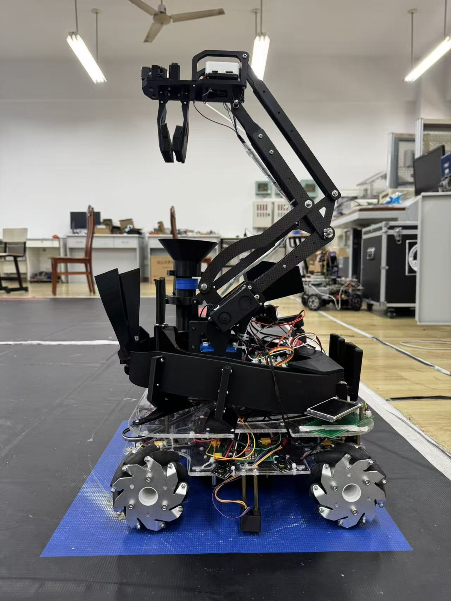
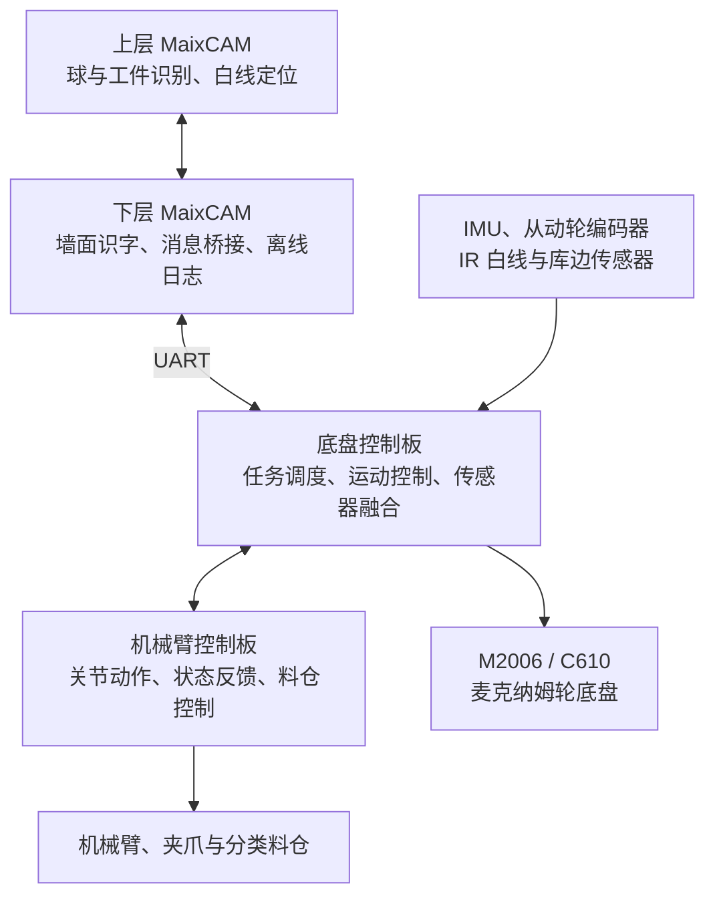
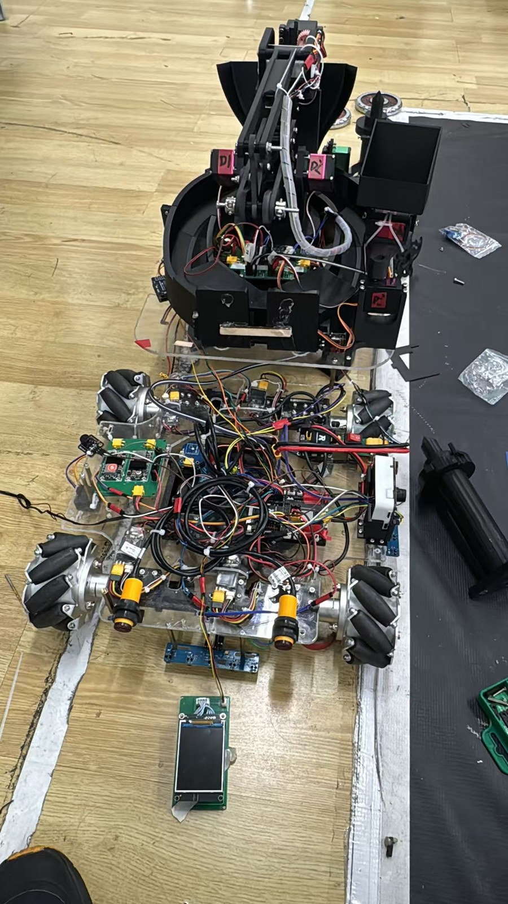

# RoboCup 2026 自动分拣机器人

**中国机器人大赛自动分拣赛道 · 国家二等奖 · 全国十二强**

基于 STM32F4 与双 MaixCAM 的自动分拣机器人项目，融合麦克纳姆轮底盘、机械臂取放、视觉识别和多板通信，完成圆盘撞球、阶梯与立桩取放、分类卸货及回零等比赛任务。

本仓库公开项目介绍、实物照片与演示材料。比赛控制程序、视觉源码、固件和标定文件不在本仓库发布。

<p align="center">
  
</p>

## 项目概况

| 项目 | 内容 |
| --- | --- |
| 开发周期 | 2026.05 — 2026.10 |
| 团队规模 | 3 人 |
| 个人角色 | 队长，负责底盘、机械臂与视觉系统集成及现场联调 |
| 主控与感知 | STM32F4、双 MaixCAM、IMU、从动轮编码器、IR 传感器 |
| 执行机构 | M2006 / C610 底盘驱动、机械臂及分类料仓 |
| 项目成果 | 中国机器人大赛自动分拣赛道国家二等奖，全国十二强 |

## 任务流程


## 系统架构



### 底盘与定位

- 联调 M2006 / C610 电机速度闭环与麦克纳姆轮运动，支持平移、转向及阶段间路线衔接。
- 结合从动轮里程计、IMU 航向反馈以及 IR 白线、库边定位，完成红蓝场路线与观察位标定。
- 将立桩转站拆成平移和原地转向，现场结合打滑、过冲等现象调整运动策略。

### 机械臂与任务协同

- 为撞球、阶梯、立桩与卸货设置对应姿态，并通过状态反馈衔接底盘与机械臂动作。
- 按圆球、方块、圆环设计取放与卸货流程，结合停顿、短距离移动等动作改善落料。
- 支持阶段单步调试和本次上电期间的姿态微调，方便现场重复测试。

### 视觉与通信

- 结合颜色、轮廓与模板识字完成目标定位，视觉结果参与底盘纠偏与抓取时序控制。
- 针对阴影导致白线断裂、字母块反光、目标丢失等现场问题，开展返图回放与流程调整。
- 多板协同采用带会话、序号、CRC 校验、回执和有限重试的串口消息，处理重复指令与阶段交接。
- 通过单步调试、状态显示、离线日志与阶段返图定位问题。

## 实物与集成

<p align="center">
  
</p>

## 个人工作与复盘

作为队长，负责底盘、机械臂与视觉系统的集成及现场联调。程序开发中使用了 AI 辅助，重点工作包括任务拆解、接口设计、参数标定、实车验证与故障排查。

这次比赛积累的经验包括：把通信问题和感知问题分开定位；通过日志与返图验证判断；将阶段调试从全程运行中独立出来；在场地条件变化时保留可回退的方案。

## 仓库内容

```text
robocup-2026-sorting-robot-showcase/
├── README.md
├── docs/
│   └── assets/          # 公开展示图片及经确认的演示动图
└── .gitignore
```

## 相关项目

- [自主物流小车](https://github.com/nikezi623/logistics-trolley)
- [Dolphin Robot Arm 桌面机械臂](https://github.com/nikezi623/dolphin_robot_arm)

## 使用说明

本仓库是项目展示资料，不提供可直接运行的比赛工程。图片、文字与演示素材未授予通用开源许可证；如需转载或使用，请通过 [GitHub](https://github.com/nikezi623) 联系作者。
