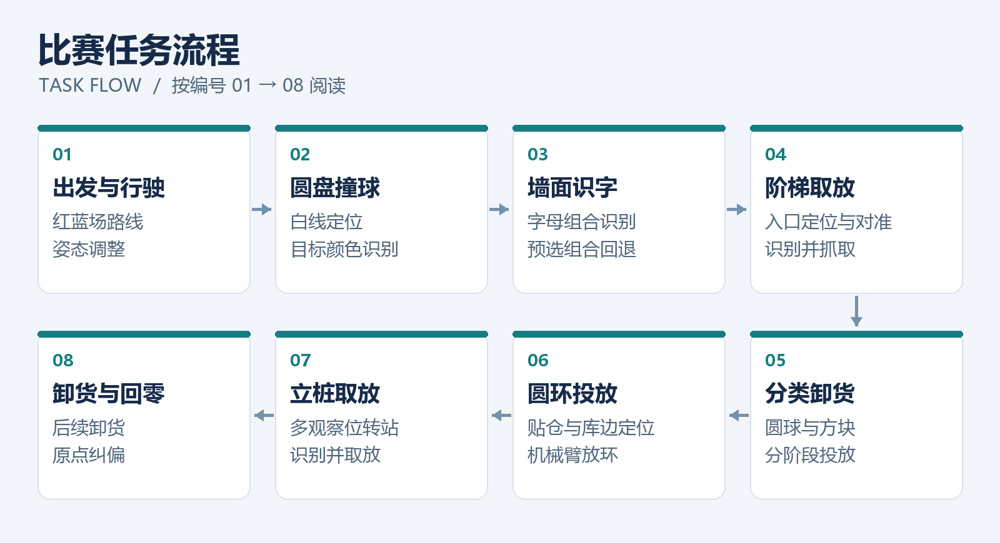
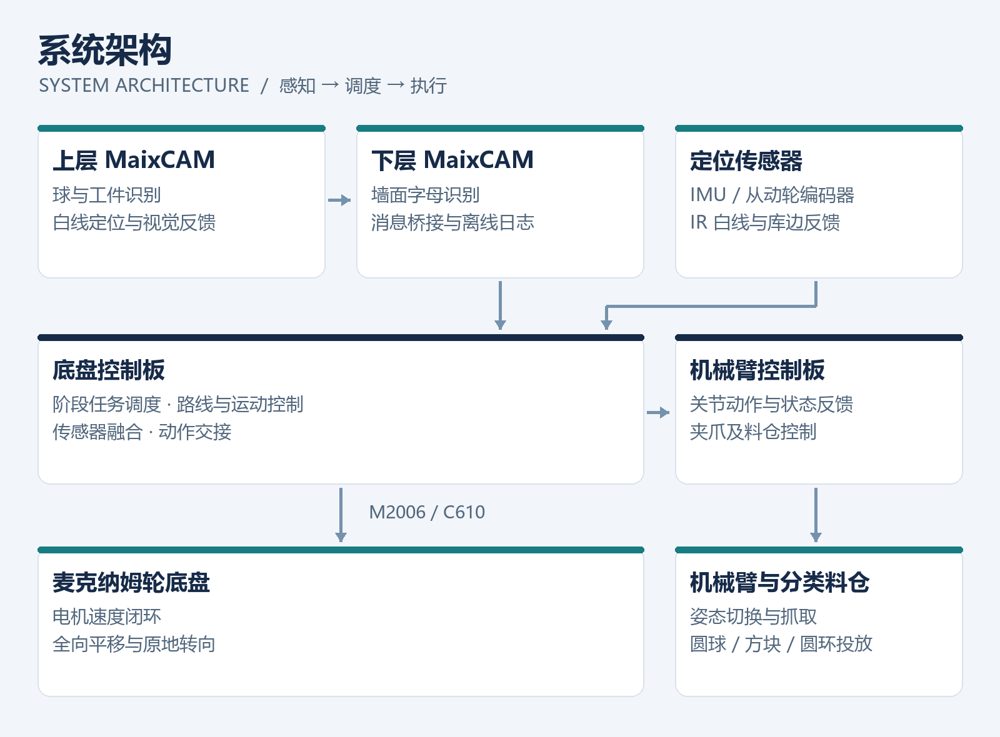

<div align="center">

# 🤖 RoboCup 2026 · 自动分拣机器人

### Autonomous Sorting Robot

**中国机器人大赛 · 自动分拣赛道**


**全向移动 × 机械臂取放 × 双相机视觉 × 多板协同**

[实物展示](#-实物展示) · [任务流程](#-任务流程) · [系统架构](#-系统架构) · [工程亮点](#-工程亮点)

</div>

基于 STM32F4 与双 MaixCAM 的自动分拣机器人，面向圆盘撞球、字母识别、阶梯与立桩取放、分类卸货及回零等任务，完成底盘控制、机械臂动作与视觉反馈的系统集成和实车联调。

> 📌 **展示仓库**：公开项目介绍、实物照片和演示资料。比赛控制程序、视觉源码、固件及标定文件不公开。

## 📷 实物展示

| 整机实物 · Robot Overview | 系统集成 · Hardware Integration |
| :---: | :---: |
|  |  |
| 麦克纳姆轮底盘、机械臂与分类料仓 | 电机驱动、控制板、传感器及整机布线 |

## 🏆 项目概况

| 比赛成果 | 开发周期 | 团队规模 | 个人角色 |
| :---: | :---: | :---: | :---: |
| **国家二等奖 / 全国十二强** | 2026.05 — 2026.10 | 3 人 | 队长 · 电控与系统集成 |

负责底盘、机械臂与视觉系统集成，以及观察位标定、跨板通信和比赛现场联调。

## 🧭 任务流程

从移动定位到识别取放，再到分类投放，按阶段组织整车任务。点击图片可放大查看。

<a href="docs/assets/task-flow.png"></a>

<details>
<summary>展开查看各阶段任务</summary>

| 阶段 | 任务 |
| --- | --- |
| 01 出发与行驶 | 红蓝场路线行驶与姿态调整 |
| 02 圆盘撞球 | 白线定位、颜色识别与撞球 |
| 03 墙面识字 | 识别字母组合，超时采用预选组合 |
| 04 阶梯取放 | 入口定位、识别、对准与抓取 |
| 05 分类卸货 | 分别投放圆球和方块 |
| 06 圆环投放 | 贴仓、库边定位与放环 |
| 07 立桩取放 | 多观察位转站、识别与取放 |
| 08 卸货与回零 | 后续卸货与原点纠偏 |

</details>

## 🛠️ 系统架构

视觉感知、任务调度与执行控制分工，通过状态反馈协调底盘和机械臂。

<a href="docs/assets/system-architecture.png"></a>

| 模块 | 主要职责 | 关键组成 |
| --- | --- | --- |
| **移动底盘** | 速度闭环、航向保持、路线行驶 | STM32F4、M2006 / C610、麦克纳姆轮 |
| **感知与定位** | 里程、航向、白线及库边反馈 | 从动轮编码器、IMU、IR |
| **双相机视觉** | 工件、白线与墙面字母识别 | 双 MaixCAM |
| **机械臂与料仓** | 姿态切换、抓取与分类投放 | 机械臂控制板、夹爪、分类料仓 |

## ⚙️ 工程亮点

### 01 · 从路线行驶到局部定位

联调 M2006 / C610 速度闭环与麦克纳姆轮运动，结合从动轮里程计、IMU 航向反馈和 IR 白线、库边定位，完成红蓝场路线及观察位标定。立桩转站采用平移与原地转向分离的方式，根据现场打滑、过冲现象调整运动策略。

### 02 · 让底盘与机械臂按状态衔接

为撞球、阶梯、立桩与卸货配置阶段姿态，通过动作反馈协调底盘停车、机械臂到位和后续执行。按圆球、方块和圆环设计不同取放流程，结合停顿与短距离移动改善落料。

### 03 · 针对现场光照迭代视觉流程

结合颜色、轮廓与模板识字定位目标，视觉结果参与纠偏与抓取时序控制。面对阴影导致白线断裂、字母块反光和目标丢失等问题，通过阶段返图回放调整检测与任务流程。

### 04 · 把调试能力做进系统

| 跨板通信 | 阶段单步调试 | 上电期间微调 | 离线排障 |
| :--- | :--- | :--- | :--- |
| 会话、序号、CRC、回执与有限重试 | 手动放到起点，单独执行阶段 | 现场调整取放姿态 | 状态显示、日志保存与阶段返图 |

## 📝 项目复盘

作为队长，负责底盘、机械臂与视觉系统集成及现场联调。程序开发中使用了 AI 辅助，主要工作包括任务拆解、接口设计、参数标定、实车验证与故障排查。

- **先留证据，再改参数**：用日志与返图区分通信、感知、动作和机械问题。
- **把阶段拆开验证**：通过单步调试缩短全程复测的等待时间。
- **为现场变化保留余地**：面对光照、摩擦和机构误差，保留微调与方案回退能力。

## 🔗 更多项目

| 自主物流小车 | Dolphin Robot Arm |
| :--- | :--- |
| [🚚 Logistics Trolley](https://github.com/nikezi623/logistics-trolley) | [🦾 桌面机械臂](https://github.com/nikezi623/dolphin_robot_arm) |
| 巡线、避障与货物投放 | STM32、PS2 手柄与三自由度机械臂 |

<details>
<summary>📂 展示资料目录与使用说明</summary>

```text
robocup-2026-sorting-robot-showcase/
├── README.md
└── docs/assets/
    ├── robot-overview.jpg
    ├── robot-integration.jpg
    ├── task-flow.png
    └── system-architecture.png
```

展示资料未授予通用开源许可证。如需转载或使用，请通过 [GitHub](https://github.com/nikezi623) 联系作者。

</details>
